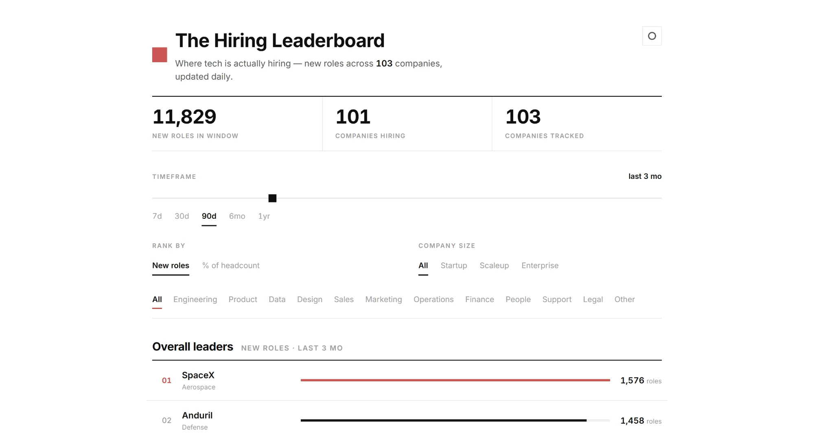

# The Hiring Leaderboard

**See where tech is actually hiring — live.** A single, self-updating view of hiring *momentum*: which companies are opening the most new roles right now, by function and relative to their size.

[](https://github.com/davidyangHY/hiring-leaderboard/actions/workflows/daily-snapshot.yml)


### ▶ [**Live demo → hiring-leaderboard.vercel.app**](https://hiring-leaderboard.vercel.app/)



---

## Overview

Job boards show you *listings*. The Hiring Leaderboard shows you **momentum** — it turns 100+ company job boards into one ranked, filterable view of who's actually ramping up. Pick a timeframe and see which companies posted the most new roles, drill into any company to see the roles by seniority, and rank by raw count or **as a share of headcount** so a fast-growing startup can out-rank a giant.

Built for job seekers deciding where to aim, and anyone tracking hiring as a signal of who's scaling.

## Features

- **New-roles leaderboard** over any timeframe — drag the slider from 7 days to a year
- **Filter** by function (Engineering, Product, Data, Design, …) and company size (startup → enterprise)
- **Rank by raw count or % of headcount** — who's growing fastest for their size
- **Company drill-down** — click any company for its roles by seniority: open ones link to the live posting, closed ones show the date they closed
- **Self-updating** — a daily pipeline refreshes everything with zero manual work

## How it works

```
100+ job boards → normalize → classify → validate → daily snapshot → dbt models → static JSON → site
```

| Stage | What happens | Tech |
|-------|--------------|------|
| **Ingest** | Fetch open roles from each company's board through one pluggable adapter, retrying transient failures | `requests`, Greenhouse / Lever / Ashby APIs |
| **Classify** | Map each role's title + department to a function and seniority | Python (ordered keyword rules) |
| **Validate** | Block the day if any company can't be fetched or suddenly reports zero roles | Python validation gate |
| **Capture** | Store a dated daily snapshot; diffing snapshots tracks when each role opens and closes (change-data-capture) | DuckDB + Parquet history |
| **Transform** | Model into staging → intermediate → marts, with data-quality tests | dbt (dbt-duckdb) |
| **Serve** | Export small static JSON the site filters entirely in-browser — no backend | vanilla JS, Vercel |
| **Orchestrate** | Run daily with an afternoon backup run, commit the refresh (auto-deploys), email on failure | GitHub Actions cron |

The business logic lives in `src/`, so the pipeline is orchestrator-agnostic — GitHub Actions runs it for free today; it would drop into Airflow unchanged if it grew to need DAG-level complexity.

## The data

- **100+ companies**, ~19,000 open roles, refreshed **every day**
- **Sources:** public applicant-tracking-system APIs — **Greenhouse, Lever, Ashby** (the same feeds their own careers pages use)
- **What's counted:** job *postings*. A role listed in three cities counts three times. That's often three real openings and sometimes one flexible-location hire; companies differ, and public data can't tell which.
- **When a role is "new":** the posting date the company's job board reports, pinned to the earliest date we've seen so a company re-dating a posting later can't move it.
- **Open vs. closed (change-data-capture):** a role is closed once it's missing from two consecutive daily snapshots, so a one-day blip can't close it. Closed roles stay in the drill-down, greyed out with the date they disappeared.
- **History:** daily snapshots since Aug 23, 2026, persisted as Parquet (the source of truth; DuckDB is a derived cache). Timeframes reaching further back only include roles that were still open on that date.
- **Coverage caveat:** only ATS-based boards are tracked. Companies on Workday / Eightfold / custom sites (e.g. Google, Meta, Netflix, Qualcomm) are intentionally excluded — those block automated access, and the tracked set is deliberately the boards meant to be read publicly.

## Reliability

An audit of the first 54 days found every run had reported success while six company-days were silently stored as zero roles, and five companies had shown no openings for weeks after moving job boards. The pipeline now fails loudly instead:

- **No silent zeros:** a fetch either returns the board's real contents or raises. Timeouts, rate limits and server errors retry with backoff; a moved board (404) fails immediately.
- **Validation gate:** before anything is written, the day is blocked if any company can't be fetched, a company with roles yesterday reports none, total roles drop more than 30%, or posting dates go missing. A blocked day saves, commits and deploys nothing, so the site keeps yesterday's data.
- **Backup run:** a second scheduled run each afternoon retries the day if the morning run never fired or was blocked, and does nothing otherwise. Re-running a day replaces it, so reruns are safe.
- **Tests on every run:** unit tests before the pipeline, dbt data tests after modeling; any failure emails the maintainer.

## Tech stack

`Python` · `DuckDB` · `dbt` · `GitHub Actions` · `Parquet` · `vanilla JS` · `Vercel`

## Run locally

```bash
pip install -r requirements.txt
python -m pytest -q tests                                # unit tests
python -m src.snapshot                                   # fetch + classify + validate + snapshot
cd dbt_project && dbt build --profiles-dir . && cd ..    # model + test
python -m src.export_json                                # export JSON for the site
python -m http.server 8000 --directory web               # open http://localhost:8000
```
